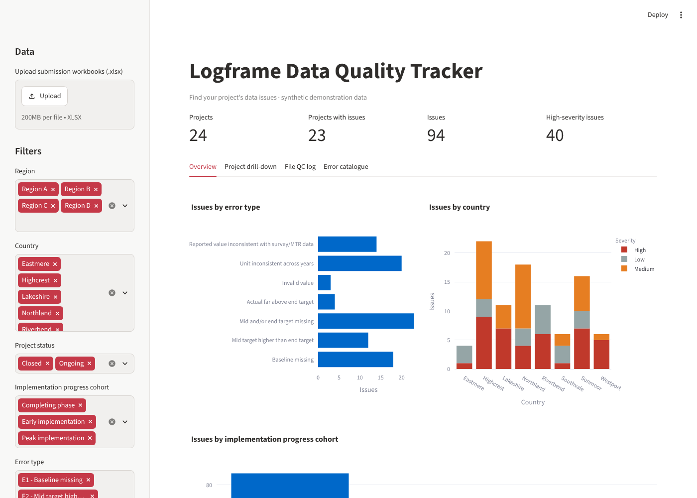

# Logframe Data Quality Tracker

**Automated validation of project logframe submissions in Excel: consolidate many workbooks, apply documented quality rules, and give every project a clear list of issues to fix – as a dashboard and as Word review reports.**

> All data in this repository is **synthetic** (fictitious projects and countries). The project reproduces, with invented data, the approach I use professionally to quality-assure results data (logframes) for a portfolio of ~200 rural development projects in a UN agency.



---

## The problem

Development projects report their results (baseline, mid-term target, end target, actual values) in Excel templates. With hundreds of projects and indicators, manual checking is slow and inconsistent, and pre-calculated error columns inside the templates are often broken or out of date. Teams need to know quickly **which project has which problem, in which row, and how serious it is**.

## What this pipeline does

```
 Excel submissions (one per country)
          │
          ▼
 1. consolidate.py ── checks sheet + columns, normalises messy headers,
          │           drops empty rows, logs file-level issues (QC log)
          ▼
 2. validate.py ───── recalculates 7 quality rules from the raw values
          │           → Error_Detail · Project_List · Error_Type tables
          ▼
 3. report.py ─────── one Word review report per project (python-docx)
          │
          ▼
 4. streamlit_app.py ─ interactive dashboard with filters and CSV download
```

| Step | Output |
|---|---|
| Consolidation | `outputs/consolidated.csv`, `outputs/qc_log.csv` |
| Validation | `outputs/error_detail.csv`, `outputs/project_list.csv`, `outputs/error_type.csv` (star-schema ready for Power BI) |
| Reporting | `outputs/reports/review_<project>.docx` – see [sample](docs/sample_review_report.docx) |
| Dashboard | `app/streamlit_app.py` |

## Validation rules

| Code | Rule | Severity |
|---|---|---|
| E1 | Baseline missing | Medium |
| E2 | Mid target higher than end target | Medium |
| E3 | Mid and/or end target missing (all multipliers) | High |
| E4 | Actual more than 3× the end target (likely unit / data-entry error) | Medium |
| E5 | Negative or non-numeric value in a numeric field | High |
| E6 | Same indicator reported with different units across years | Low |
| E7 | Actual differs >20% from the survey / MTR value | High |

Tolerances are set in one place (`src/config.py`) so they can be reviewed and changed without touching the rules. Each rule is a small, separately tested function (`tests/test_rules.py`).

Projects are also grouped into **implementation progress cohorts** (Start-up, Early, Peak, Completing) based on the share of the project's duration elapsed, so issues can be compared across projects at similar stages.

## Lessons built into the design

- **Recalculate, never trust stored error flags.** Error columns inside source templates were found to contain `#REF!` or constant values; all rules are recomputed from raw columns.
- **Headers are messy.** A double space (`'End  Target '`) silently breaks a lookup. Headers are normalised and every change is logged.
- **Keep the detail table at the right grain.** Validation produces a row-level fact table; summaries are computed on top of it (DAX measures in Power BI, `groupby` here), which keeps every page filterable.
- **One bad file must not stop the batch.** File-level problems go to a QC log and the rest is processed.

## Quick start

```bash
git clone https://github.com/claudia-mavila2020/logframe-data-quality-tracker.git
cd logframe-data-quality-tracker
pip install -r requirements.txt

python -m src.generate_synthetic_data     # create 8 synthetic country workbooks
python run_pipeline.py                    # consolidate, validate, write CSVs and Word reports
pytest                                    # run the rule tests
streamlit run app/streamlit_app.py        # open the dashboard
```

To run it on your own files: `python run_pipeline.py --input path/to/folder`, or upload `.xlsx` files from the dashboard sidebar. Workbooks need a sheet named `Logframe` with the columns listed in `src/config.py`.

## Repository structure

```
├── app/streamlit_app.py          dashboard
├── data/synthetic/submissions/   synthetic Excel workbooks (input)
├── docs/                         screenshots and a sample Word report
├── outputs/                      generated tables (CSV)
├── src/
│   ├── config.py                 schema, error catalogue, tolerances
│   ├── generate_synthetic_data.py
│   ├── consolidate.py
│   ├── validate.py
│   └── report.py
├── tests/test_rules.py
└── run_pipeline.py
```

## Tools

Python (pandas, openpyxl, python-docx, Streamlit, Plotly, pytest). The original production version uses Power BI (Power Query M, DAX) on top of the same three-table model.

## Author

**Claudia Avila Cueva** – Data & AI Consultant · [LinkedIn](https://www.linkedin.com/in/claudiaavilacueva/)

Built with AI-assisted development (Claude); all code reviewed and tested.
